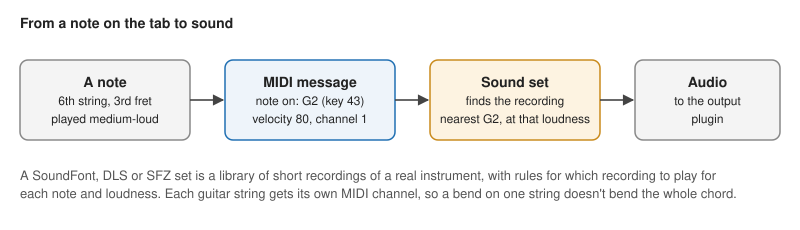

# MIDI plugin

This is the plugin that makes a score sound. When you press Play, it turns every note of every track into audio, using a **sound set**: a library of recorded or synthesised instruments in one of the standard formats, SoundFont (`.sf2`, `.sf3`), DLS (`.dls`) or SFZ (`.sfz`). It plays the moment you open a song, using whatever set your system already has, and gets much better when you give it a good one. [How to use it](use-cases.md) shows how.

Its name in OxiGuitar is **MIDI (SoundFont, SFZ)**. It replaces the older SoundFont plugin: settings and data are carried over once, and a leftover `soundfont.oxp` can be deleted.

It plays through whatever audio output plugin you have installed. Without one, nothing reaches your speakers.

## MIDI in one paragraph

**MIDI** is the language electronic instruments have spoken since the early 1980s. It doesn't carry sound, only instructions: "start playing G2, this loud, on channel 1", "bend that note up a little", "stop it now". Something else has to turn those instructions into sound. On a keyboard it is the keyboard's own synthesiser; in OxiGuitar it is this plugin. Not to be confused with MIDI *files*, which store those instructions on disk: OxiGuitar opens those through a different plugin.

**General MIDI** is the agreement that makes any MIDI song sound roughly right anywhere: a fixed list of 128 instruments (number 25 is a nylon-string guitar, 30 an overdriven one, 34 a fingered bass…) and a fixed drum map (36 is the bass drum, 38 the snare…). Guitar Pro files name their instruments this way, so the plugin knows what each track is meant to sound like.

## Sound sets

A sound set is what gives MIDI its voice. The formats the plugin reads all work the same way: they are libraries of short recordings ("samples") of a real instrument, plus rules for which recording to play for which note and how hard it was played, how to loop it while the note is held, and how to fade it out.

- **SoundFont** (`.sf2`, and `.sf3` with compressed samples) packs a whole General MIDI orchestra into one file. Every system can have one, and they are small, but each instrument usually has only a few recordings, stretched across many notes.
- **DLS** (`.dls`) is a similar format. macOS and Windows ship their basic General MIDI instruments this way.
- **SFZ** (`.sfz`) is a plain text file pointing at a folder of recordings. SFZ instruments tend to be one instrument recorded in depth: every string and fret, soft and hard, sometimes several takes of each. They sound far more like the real thing and take far more disk.

The basic set your system comes with is enough to hear the notes. A good recorded set is the single biggest improvement you can make to how OxiGuitar sounds. The [sound set installer](https://mateusrdp.github.io/oxiguitar-bettersounds-soundfonts/) downloads a free recommended collection if you don't want to hunt for one.

## Why guitars need special care

On a keyboard, a pitch bend bends every note that is sounding. On a guitar you bend one string while the others ring. So the plugin gives each string of a guitar track its own MIDI channel where the 16 channels allow, and each string's bends, slides and vibrato stay on that string.
