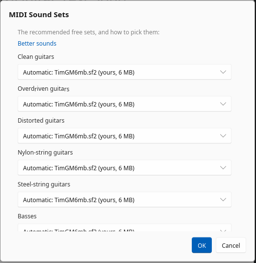
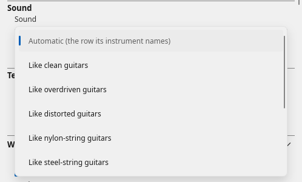

# How to use it

## Choose the sound sets

**Plugins → MIDI Sound Sets…** opens the dialog that decides what every kind of track sounds like, with or without a song open:

Each row picks a set: **Automatic** takes the best one the plugin finds for that kind of instrument, or pick any set from your `soundfonts` folder. Your picks take effect when you press **OK**; **Cancel** leaves them as they were.

## Give one track its own sound

On the **Track** tab, the **Sound** section decides which row a track follows:

**Automatic** follows the track's instrument. Pick another row to make, say, a distorted guitar part play with the clean guitar set, which is what an amp model needs. Or give the track a set of its own.

## What you can do with it

- Play a score the moment it is open. Every system has some General MIDI sound set, so nothing else is needed to hear it.
- Choose better instruments. Put your own sound sets in OxiGuitar's `soundfonts` folder and pick them under **Plugins → MIDI Sound Sets…**. The dialog has a row for clean, overdriven and distorted electric guitars, nylon and steel guitars, basses, drums and everything else.
- Give one track a different sound. The Track tab's **Sound** section lets a track follow another row or use a set of its own. That is also how you play a distorted guitar clean into an amp model.
- Use recorded sets. SFZ sets with real samples sound much closer to the instrument. The [sound set installer](https://mateusrdp.github.io/oxiguitar-bettersounds-soundfonts/) downloads a free recommended collection, if you don't want to hunt for one.

The first time a score plays with only the basic system set, OxiGuitar says so once and links to the sound set installer.

## Where sound sets go

| System | Your sound sets |
| --- | --- |
| Linux | `~/.local/share/oxiguitar/soundfonts/`, or `/usr/share/oxiguitar/soundfonts/` for every user |
| macOS | `~/Library/Application Support/OxiGuitar/soundfonts/` |
| Windows | `%APPDATA%\OxiGuitar\soundfonts\` |
| OxiGuitar's Flatpak | `~/.var/app/io.github.mateusrdp.OxiGuitar/data/oxiguitar/soundfonts/` |

A file called `oxiguitar-set.json` beside a set gives it a short name, a role, a licence and a credit, and tells the plugin which patch of a multi-patch set to prefer.
